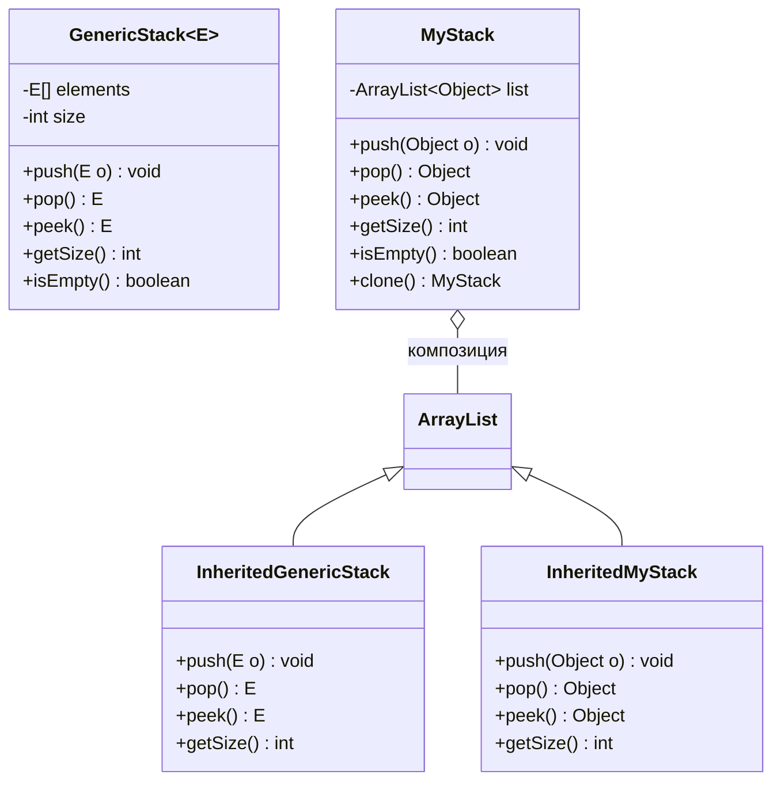

# Практическая работа №5

Дженерики, алгоритмы поиска, стек и клонирование.

## Задание 1: алгоритмы (`src/generics/`)

- `Algorithms` — четыре обобщённых метода: `removeDuplicates` (снимает повторы через `contains`), `linearSearch` (позиция элемента или -1), `max` для одномерного и двумерного массивов через `compareTo()`.
- `Circle` — класс с полем `radius`, реализует `Comparable<Circle>`: сравнение по радиусу.
- `Main` — демонстрирует все четыре метода.

## Задание 2: GenericStack (`src/genericstack/`)

- `GenericStack<E>` — стек на массиве: перед `push` проверяется заполненность, при переполнении создаётся массив вдвое больше и элементы переносятся.
- `InheritedGenericStack<E>` — стек наследуется от `ArrayList<E>` (отношение is-a).
- `Main` — запрашивает пять строк и выводит их в обратном порядке; ниже показывает удвоение массива при переполнении.

## Часть 2: MyStack и клонирование (`src/mystack/`)

- `MyStack` — композиция: содержит `ArrayList<Object>` как поле и реализует `clone()` с глубокой копией списка (копия получает свой собственный `ArrayList`).
- `InheritedMyStack` — тот же стек, но наследование от `ArrayList<Object>`.
- `Main` — пять строк в обратном порядке из унаследованного стека, затем демонстрация глубокой копии: `push` в копию не меняет оригинал.

## Запуск из этой папки

```fish
./run.sh        # меню выбора задания
./run.sh 1      # алгоритмы
./run.sh 2      # GenericStack
./run.sh 3      # MyStack
```

## UML


