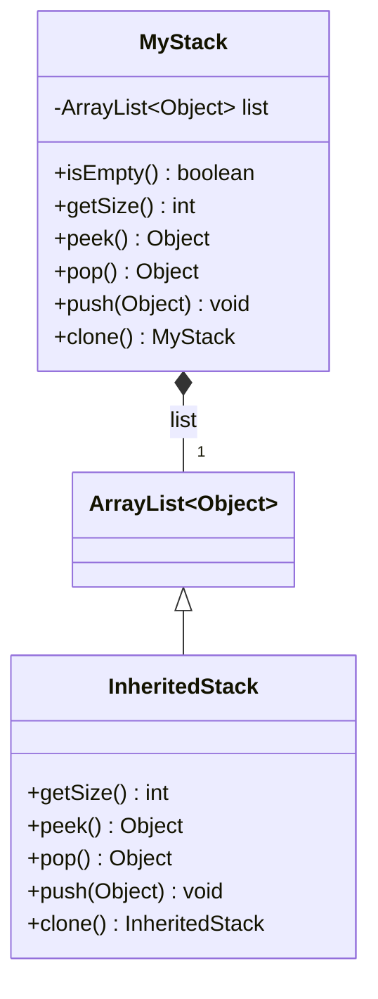
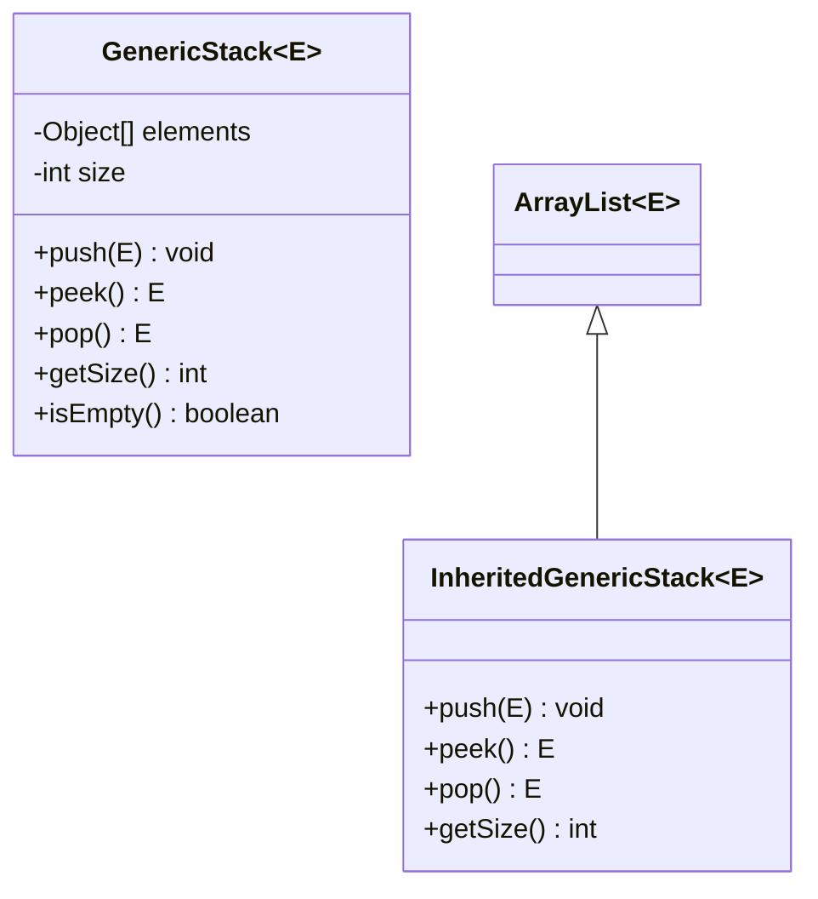

# Практическая работа №5

Композиция, наследование, стек и клонирование в Java.

- `Algorithms` реализует удаление повторов через `contains`, линейный поиск и поиск максимума в одно- и двумерном массивах. `Circle` сравнивается по радиусу.
- `GenericStack<E>` хранит элементы в массиве, удваивая его при заполнении. `InheritedGenericStack<E>` наследует `ArrayList<E>`. Клиент считывает пять строк и выводит их в обратном порядке дважды: из унаследованного стека (задание №2) и из `InheritedStack`, унаследованного варианта `MyStack` из задания.
- `MyStack` содержит `ArrayList<Object>` и реализует стек через композицию. `clone()` создаёт отдельный список для копии.
- `InheritedStack` наследуется от `ArrayList<Object>` и реализует те же операции стека. Демонстрирует необобщённый вариант.
- `StackTest` проверяет операции, ошибки при пустом стеке и независимость списков после клонирования.

Копируются сами списки, но не объекты, на которые ссылаются их элементы. Для неизменяемых строк это безопасно; изменяемые объекты в обоих стеках останутся общими.

[Конспект к защите](THEORY-AND-RESULTS.md)

## Запуск из этой папки

```fish
./run.sh
```

## Проверка

```fish
mkdir -p /tmp/java-practice-05-test
javac -encoding UTF-8 -d /tmp/java-practice-05-test src/stack/*.java tests/StackTest.java
java -ea -cp /tmp/java-practice-05-test StackTest
```

## UML




