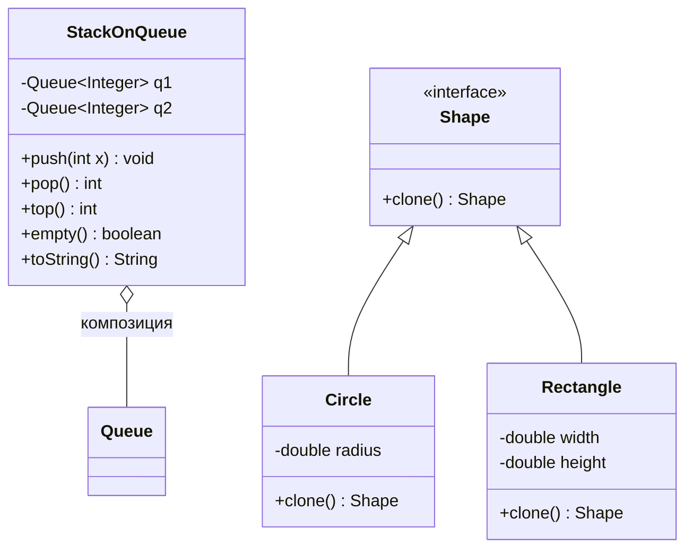

# Практическая работа №6

Очередь, стек поверх очереди и порождающий паттерн Prototype (вариант №5).

## Задачи 1–2: стек из двух очередей (`src/queue/`)

- `StackOnQueue` — стек (LIFO) поверх не более чем двух очередей FIFO, отношение — композиция. Используются только стандартные методы очереди: `add`, `peek`, `poll`, `size`, `isEmpty`.
- `Main` — тестовый класс: создаёт стек, добавляет два значения, выводит вершину без удаления, затем с удалением, проверяет стек на пустоту и выводит все элементы.

Принцип: в `q1` элементы всегда лежат в порядке стека (вершина — первый элемент). `push` кладёт новый элемент в `q2`, перегоняет туда всю `q1` и меняет очереди местами, поэтому новый элемент оказывается первым. Отсюда `push` — O(n), `pop`/`top`/`empty` — O(1).

## Вариант №5: Prototype (`src/prototype/`)

- `Shape` — интерфейс с методом `clone()`: контракт «фигура умеет создавать свою копию».
- `Circle` — поле `radius`, `Rectangle` — поля `width` и `height`. `clone()` реализован через `super.clone()`: Java создаёт новый объект и копирует поля.
- `PrototypeMain` — клиентский код: создаёт оригиналы, клонирует их, меняет свойства только копий и показывает, что оригиналы остались неизменными.

## Запуск из этой папки

```fish
./run.sh        # появится меню выбора задания
./run.sh 1      # стек из двух очередей (задачи 1-2)
./run.sh 2      # Prototype, вариант 5
```

Собирает оба пакета во временную папку и запускает выбранное.

## Проверка вручную

```fish
mkdir -p /tmp/java-practice-06
javac -encoding UTF-8 -d /tmp/java-practice-06 src/queue/*.java src/prototype/*.java
java -cp /tmp/java-practice-06 queue.Main
java -cp /tmp/java-practice-06 prototype.PrototypeMain
```

## UML


